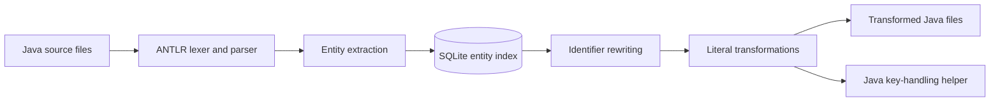

<div align="center">

# Java Source Obfuscator

**An ANTLR-based research prototype for analyzing and transforming Java source code.**

[Research paper](http://i4c.iust.ac.ir/UPL/Paper2023/accpapers/i4c2023-1103.pdf) · [Source examples](app/benchmarks) · [MIT License](LICENSE)

</div>

This repository explores Java source-code obfuscation through **syntax-aware identifier rewriting and encrypted literal transformation**. It parses Java source with ANTLR, records program entities in a local SQLite database, and applies source transformations through token-stream rewriting. Its implementation accompanies an academic paper presented at **I4C 2023**.

It is an **experimental research implementation**, not a drop-in replacement for a production obfuscator, a general Java build plugin, or a guarantee against reverse engineering.

## How it works



The implemented pipeline has three main stages:

1. **Entity extraction.** Walks ANTLR's parsed Java structure, collecting information about classes, interfaces, methods, constructors, fields, variables, and other supported declarations into a Peewee/SQLite model.
2. **Renaming.** Uses that entity information to rewrite identifiers and relevant references while working through the Java parse tree.
3. **Literal transformation.** Rewrites selected literals into runtime decode expressions, using encryption helpers and a bundled Java utility for key-handling artifacts.

The source code for these stages lives in `app/visitors/extractor.py`, `renamer.py`, and `encryptor.py`, with orchestration in `app/executer.py`.

## Highlights

- **Syntax-aware source transformation:** ANTLR Java lexer/parser and parse-tree listeners rather than regular-expression-only replacement.
- **Cross-reference bookkeeping:** entity metadata is indexed in a local SQLite database using Peewee.
- **Several identifier categories:** class, field, method, parameter, local-variable, and related declarations are represented in the extraction model.
- **Literal rewriting:** the encryption visitor contains handling for strings and several Java primitive/wrapper types through generated decode expressions.
- **Included examples:** the `app/benchmarks/` directory contains sample Java projects and an example generated-output tree.

The repository documents a research exploration. It has only a minimal command-line interface for the bundled examples. It does **not** have a comprehensive compatibility matrix across Java language versions, or a regression suite proving semantics preservation for arbitrary projects.

## Get started

### Prerequisites

- Python 3, with `venv` and `pip` available.
- A Java runtime for the bundled key-handling helper (`java -version`).
- A trusted development environment. The tool invokes a **bundled JAR**; inspect third-party binaries before running them.

The checked-in Python lexer was generated by **ANTLR 4.13.1**. `requirements.txt` pins the matching `antlr4-python3-runtime==4.13.1` and also lists `peewee` and `cryptography`, which the encryptor uses:

```bash
git clone https://github.com/ali-hamedi/Obfuscator.git
cd Obfuscator

python -m venv .venv
source .venv/bin/activate

python -m pip install -r requirements.txt
java -version
```

The repository already includes generated ANTLR parser/lexer Python files in `app/gen/`. **You do not need to regenerate the grammar to try the checked-in example.** The original README's ANTLR 4.9.1 regeneration step is outdated for these generated files.

### Run the included example

The entry point is `app/main.py`. By default it processes `project3`, reading Java files from `app/benchmarks/project3/main/`.

From the repository root:

```bash
python -m app.main                      # default: --project project3
python -m app.main --project project2
python -m app.main --list               # list bundled projects
python -m app.main --help
```

Project names are validated before any processing starts. Only plain directory names of bundled projects under `app/benchmarks/` are accepted, and `output` is reserved.

The pipeline attempts to extract entities, rename supported identifiers, transform selected literals, and write output under the corresponding `app/benchmarks/output/main/` structure. It also creates/uses `obfuscator.db` at the working-directory root and invokes `app/visitors/utils/jos.jar` for key-handling output.

**Caution:** This command overwrites files with the same names in the example output tree and regenerates the key-handling files there. It also resets the local SQLite database. Make a copy or work in a disposable clone before experimentation. If `java` is missing or the helper fails, the run now stops with an error instead of reporting success.

### Change the input project

Use `--project <name>` to select a bundled input. There are **no `--input` / `--output` flags for arbitrary paths**. `Executer` reads from:

```text
app/benchmarks/<project-name>/main/
```

and writes each file to the same relative location under `app/benchmarks/output/main/`.

If you adapt this to your own project, first inspect the package, import, and helper assumptions in `app/executer.py` and the visitors. Several transformations refer to the bundled `ir.ac.kntu.MyCipher` helper, so arbitrary Java project layouts are **not guaranteed** to work without code changes.

### Inspect the result

The repository contains both input examples and generated output. Start with:

- [`app/benchmarks/project3/`](app/benchmarks/project3/) — example input project.
- [`app/benchmarks/output/`](app/benchmarks/output/) — sample transformed Java tree.
- [`app/visitors/`](app/visitors/) — transformation logic.

Inspect whether the transformed project still compiles, behaves equivalently on your test cases, and handles application-specific dependencies. The Python script's completion alone is **not** evidence of successful Java compilation or behavioral equivalence.

Compiling the transformed output of each bundled project with `javac` (with `MyCipher.java` and `KeyStoreReader.java` added) currently gives:

| Project | Transformed output compiles? | Observed problem |
| --- | --- | --- |
| project1 | No (1 error) | Literal rewriting emits an extra `)` in an `int` expression |
| project2 | Yes | — |
| project3 | No (5 errors) | Some method call sites are not renamed consistently with their declarations |
| project4 | No (2 errors) | Enum constants used as `switch` case labels are renamed inconsistently |

Runtime behaviour was not compared, because it would require the generated key files.

### Tests

```bash
python -m pip install -r requirements-dev.txt
python -m pytest tests
```

The tests run the pipeline on a temporary copy of `app/`, so tracked examples are never modified. The bundled key-handling JAR is stubbed out, so no key material is generated. They cover the CLI, parser loading, entity extraction, output placement, and compilation of project2. Project3 compilation is a strict expected failure.

## Repository structure

```text
Obfuscator/
├── app/
│   ├── main.py                  # Command-line entry point (--project, --list)
│   ├── executer.py              # Extract → rename → encrypt → write pipeline
│   ├── data/
│   │   ├── db.py                # Peewee/SQLite queries and initialization
│   │   └── models/ent.py        # Entity model
│   ├── gen/                     # Generated ANTLR Java lexer/parser/listener
│   ├── visitors/
│   │   ├── extractor.py         # Collect declarations and related entities
│   │   ├── renamer.py           # Identifier transformations
│   │   ├── encryptor.py         # Literal transformations
│   │   └── utils/               # Java helper sources and bundled JAR
│   └── benchmarks/
│       ├── project1/ ... project4/ # Example Java inputs
│       └── output/              # Example generated artifacts
├── tests/                       # pytest suite (runs on temporary copies)
├── requirements.txt
├── LICENSE
└── README.md
```

## Technical notes and scope

| Aspect | Current implementation |
| --- | --- |
| Language | Java source processed by a generated ANTLR parser |
| Transformation engine | Parse-tree extraction plus `TokenStreamRewriter` |
| Entity index | Local SQLite / Peewee |
| Obfuscation | Identifier changes and selected literal transformations |
| Runtime decode support | Generated Java expressions calling `MyCipher` |
| Project selection | `--project <name>` for bundled examples (default `project3`) |
| CLI / packaging | Minimal argparse CLI; no arbitrary input/output paths and no installable Python package |
| Behavioral verification | Compile check for bundled examples (see table above); no semantics-preservation suite |

**Security limitations.** Obfuscation makes code harder to read, but cannot ensure secrecy or prevent a determined analyst from recovering behavior. Cryptographic operations do not change that boundary when the transformed program must also contain or obtain everything necessary to decode values at runtime. This research prototype should not be used as the sole protection for sensitive intellectual property, secrets, or production software.

**Artifact hygiene.** The repository currently tracks sample generated cryptographic artifacts, including `key.txt` and `keystore.p12`, under `app/benchmarks/output/`, plus a SQLite database at the root. Treat them as potentially sensitive until independently verified to be synthetic examples. Never commit real keys or secrets. Files that were previously public remain recoverable from Git history even after later removal; real credentials would need revocation or rotation.

## Research publication

**Mohammadhadi Alaeiyan, Ali Hamedi, M. A. SoltanBeigi, AmirReza Parvahan, and AmirAli Ghaedi.**  
*Enhancing Code Privacy: An Exploratory Implementation of Java DataFlow Obfuscation.*  
Proceedings of the 8th International Conference on Combinatorics, Cryptography, Computer Science and Computation (I4C), 2023.

[Read the paper (conference PDF)](http://i4c.iust.ac.ir/UPL/Paper2023/accpapers/i4c2023-1103.pdf)

```bibtex
@inproceedings{alaeiyan2023codeprivacy,
  title     = {Enhancing Code Privacy: An Exploratory Implementation of Java DataFlow Obfuscation},
  author    = {Alaeiyan, Mohammadhadi and Hamedi, Ali and SoltanBeigi, M. A. and Parvahan, AmirReza and Ghaedi, AmirAli},
  booktitle = {Proceedings of the 8th International Conference on Combinatorics, Cryptography, Computer Science and Computation (I4C 2023)},
  year      = {2023},
  url       = {http://i4c.iust.ac.ir/UPL/Paper2023/accpapers/i4c2023-1103.pdf}
}
```

## Development and research directions

If extending the implementation, high-value improvements include fixing the renaming defects listed above, explicit input/output directories with an isolated and configurable output path, a behavioural comparison harness, safer key-material lifecycle management, and automated comparisons between input and transformed program behavior.

Contributions should preserve the experimental intent and clearly distinguish implemented functionality from proposed transformations. Open an issue before making broad changes to parser logic or the encryption helper.

## License

Released under the [MIT License](LICENSE). The linked research paper should be cited when the implementation informs academic work.
